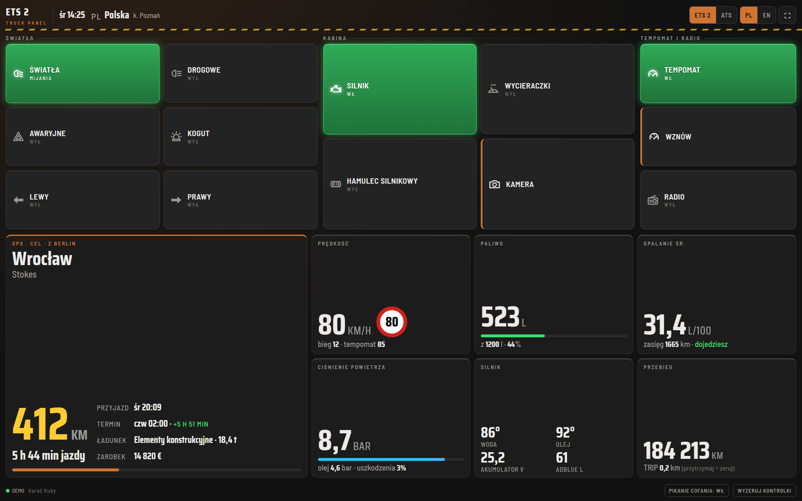
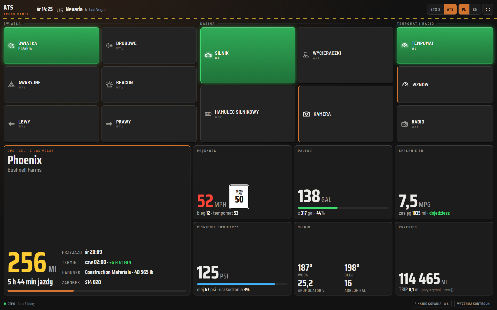
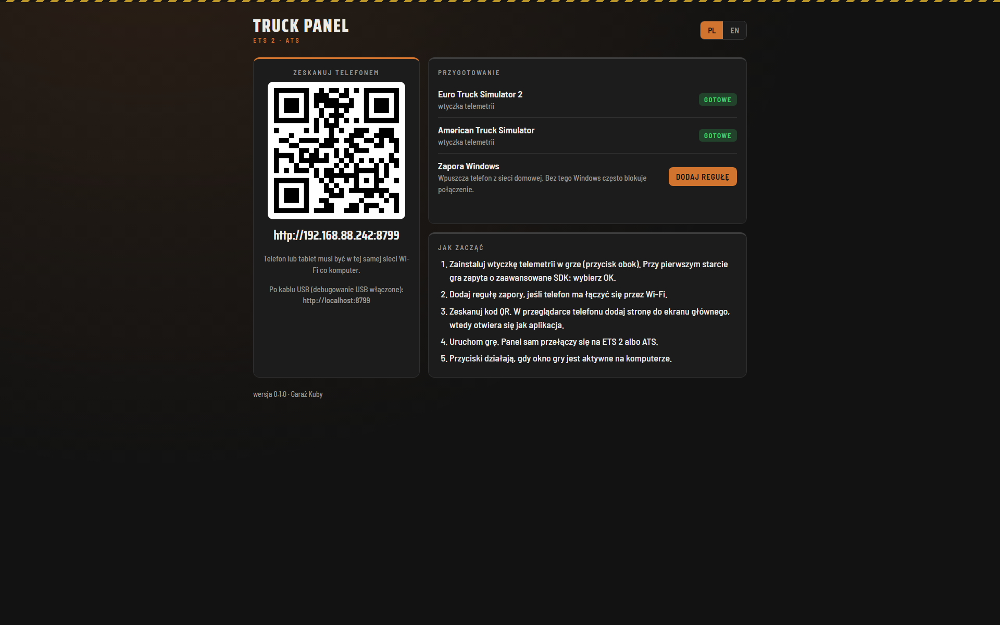

# Garaż Kuby Truck Panel (ETS 2 / ATS)

**Darmowy panel na telefon albo tablet do Euro Truck Simulator 2 i American Truck Simulator.**
Przyciski jak w kabinie (światła, kierunki, awaryjne, zapłon, silnik, hamulec silnikowy, tempomat, kamera, radio)
i deska z danymi prosto z gry: GPS do celu, prędkość z ograniczeniem, paliwo, powietrze, temperatury, przebieg.

Na telefonie nic nie instalujesz: panel działa w zwykłej przeglądarce (Chrome, Brave, Safari).

| ATS (mile, galony, dolary) | Strona startowa na komputerze |
|---|---|
|  |  |

*A free phone/tablet dashboard for ETS 2 and ATS: cab switches plus live telemetry, PL/EN switch at the top. [English below](#english).*

---

## ⬇️ Pobierz

### [Pobierz Garaz-Kuby-Truck-Panel.zip](https://github.com/GarazKuby87/garazkuby-truck-panel/releases/latest/download/Garaz-Kuby-Truck-Panel.zip)

Wszystkie wersje: [Releases](https://github.com/GarazKuby87/garazkuby-truck-panel/releases)

**Potrzebne:**
- komputer z Windows 10 lub 11,
- ETS 2 i/lub ATS ze Steama,
- telefon albo tablet w **tej samej sieci Wi-Fi** co komputer.

---

## 🛠️ Instalacja krok po kroku

### 1. Rozpakuj i uruchom
1. Rozpakuj pobrany plik `.zip`, na przykład do folderu Pobrane.
2. Uruchom **TruckPanel.exe**.
3. Windows może pokazać niebieskie okno **„System Windows ochronił ten komputer”** (SmartScreen).
   To normalne przy nowych programach bez płatnego certyfikatu. Kliknij **Więcej informacji → Uruchom mimo to**.
4. Jeśli Windows zapyta o dostęp do sieci, zezwól. Telefon łączy się z panelem przez Twoje Wi-Fi.
   Nic nie jest wysyłane poza Twój komputer.
5. Otworzy się czarne okno programu i strona startowa w przeglądarce z kodem QR.
   **Nie zamykaj czarnego okna**, dopóki grasz. Zamknięcie go wyłącza panel.

### 2. Zainstaluj wtyczkę do gry
1. Na stronie startowej, w sekcji **Przygotowanie**, kliknij **Zainstaluj** przy swojej grze (ETS 2 i/lub ATS).
   Panel sam znajduje, gdzie Steam ma zainstalowane gry.
2. Status zmieni się na **gotowe**.
3. Przy pierwszym uruchomieniu gry pojawi się pytanie o **zaawansowane funkcje SDK**. Kliknij **OK**.
   Bez tego panel nie dostanie danych z gry.

Wtyczka to darmowa telemetria `scs-telemetry.dll` (RenCloud scs-sdk-plugin). Trafia do `bin\win_x64\plugins` w folderze gry.

### 3. Wpuść telefon przez zaporę Windows
1. W sekcji **Zapora Windows** kliknij **Dodaj regułę**.
2. Potwierdź okienko Windows (**Tak**).
3. Status zmieni się na **gotowe**.

Reguła wpuszcza tylko urządzenia z Twojej sieci domowej. Bez niej Windows często blokuje połączenie z telefonu.

### 4. Połącz telefon albo tablet
1. Telefon w tym samym Wi-Fi co komputer, nie na danych komórkowych.
2. Zeskanuj aparatem **kod QR** ze strony startowej. Panel otworzy się w przeglądarce.
3. Na górze panelu możesz przełączyć język **PL / EN** i przejść na pełny ekran.
4. Wskazówka: w menu przeglądarki wybierz **„Dodaj do ekranu głównego”**. Panel będzie się otwierał jak aplikacja.

### 5. Graj
1. Uruchom ETS 2 albo ATS. Panel sam rozpozna grę (w ATS pokazuje mile, galony, °F i dolary).
2. Przyciski działają, gdy **okno gry jest aktywne** na komputerze.
3. Panel sam dopasowuje się do ekranu: telefon, tablet, poziomo albo pionowo.

---

## ⌨️ Jednorazowo: przypisz kilka klawiszy w grze

Przyciski panelu naciskają klawisze w grze. Większość to domyślne klawisze, ale kilka akcji nie ma domyślnego klawisza.
W grze wejdź w **Opcje → Sterowanie**, znajdź akcję i przypisz klawisz:

| Przycisk w panelu | Akcja w grze | Klawisz |
|---|---|---|
| Zapłon | Elektryka / zapłon (*Electricity / ignition*) | `\` (klawisz **nad Enterem**, z `\|`, nie `/`) |
| Hamulec silnikowy | Hamulec silnikowy: przełącz (*Engine brake toggle*) | `J` |
| Kamera | Przełączanie kamer (*Cycle cameras*) | `9` |
| Wznów (tempomat) | Tempomat: wznów (*Cruise control resume*) | `/` |
| Radio | Radio (*Radio*) | `F8` |

Przycisk **Silnik** to rozruch (`E`, domyślny klawisz gry). Silnik gaśnie, gdy wyłączysz **Zapłon**.
**Ręczny** (`Spacja`) i **Naczepa** (`T`, podepnij/odepnij) to domyślne klawisze gry. Jeśli masz je na kierownicy, dopisz klawisz w drugim polu.

**Masz kierownicę albo panel przycisków (PXN, Moza, Fanatec, Thrustmaster...)?**
Gdy w grze przypisujesz akcję do przycisku kierownicy, gra często usuwa przy tym klawisz z klawiatury.
Wtedy ten przycisk w panelu przestaje działać. Rozwiązanie: w **Opcje → Sterowanie** dopisz klawisz
w drugim (alternatywnym) polu tej akcji. Przycisk na kierownicy zostaje.

---

## ❓ Coś nie działa?

| Problem | Co zrobić |
|---|---|
| Telefon nie otwiera panelu | Sprawdź, czy telefon jest w tym samym Wi-Fi (nie na danych komórkowych) i czy reguła zapory ma status „gotowe”. Sieć gościnna w routerze często blokuje połączenia między urządzeniami. |
| Panel się otwiera, ale nie ma danych z gry | Wtyczka niezainstalowana albo w grze nie kliknięto **OK** przy pytaniu o SDK. Zainstaluj wtyczkę i uruchom grę ponownie. |
| Przyciski nic nie robią | Kliknij w okno gry, żeby było aktywne. Sprawdź klawisze z tabeli powyżej. |
| Działa wszystko poza jednym przyciskiem | Masz tę akcję na kierownicy i gra skasowała klawisz: dopisz go w drugim polu. |
| Zamknąłem stronę startową | Wejdź w przeglądarce na `http://localhost:8765` albo uruchom TruckPanel.exe ponownie. |
| Antywirus blokuje TruckPanel.exe | To fałszywy alarm, częsty przy programach spakowanych PyInstallerem. Kod jest w tym repozytorium, możesz go przejrzeć albo zbudować exe sam (niżej). |

### Połączenie kablem USB (opcjonalnie, Android)
Zamiast Wi-Fi możesz podłączyć telefon z Androidem kablem. Potrzebne:
- włączone **debugowanie USB** w telefonie: [instrukcja Google](https://developer.android.com/studio/debug/dev-options?hl=pl),
- `adb\adb.exe` w folderze obok TruckPanel.exe ([Android SDK Platform Tools](https://developer.android.com/tools/releases/platform-tools)).

Wtedy panel działa w telefonie pod adresem `http://localhost:8765`.

---

## Jak to działa
- `TruckPanel.exe` to mały serwer na Twoim komputerze. Strona startowa pokazuje kod QR z jego adresem w sieci domowej.
- Dane z gry daje wtyczka telemetrii, a panel pokazuje je w przeglądarce telefonu.
- Klawisze trafiają do gry tylko wtedy, gdy jej okno jest aktywne. Serwer odpowiada wyłącznie urządzeniom z sieci lokalnej,
  a zmiany na komputerze (wtyczka, zapora) można zrobić tylko ze strony otwartej na samym komputerze.
- Panel nie wysyła żadnych danych do internetu.

## Budowanie ze źródeł
Potrzebny Python 3.12+ na Windows. Uruchom `zbuduj.bat`, gotowy plik pojawi się w `dist\TruckPanel.exe`.
Bez budowania: `python app/serwer.py`.

## Licencja
GNU GPL v3, pełny tekst w pliku [`LICENSE`](LICENSE). Cudze składniki (wtyczka telemetrii RenCloud, generator QR,
czcionki, lista miast z truckermudgeon/maps) mają swoje licencje opisane w [`THIRD_PARTY.md`](THIRD_PARTY.md) i katalogu `licencje/`.

Euro Truck Simulator 2 i American Truck Simulator to znaki towarowe SCS Software. Projekt nie jest z nimi powiązany.

---

## English

**Garaż Kuby Truck Panel** is a free phone/tablet dashboard for Euro Truck Simulator 2 and American Truck Simulator:
cab switches (lights, indicators, hazards, ignition, engine, engine brake, cruise control, camera, radio) and live data
(GPS to destination, speed and limit, fuel, air pressure, temperatures, odometer). Nothing to install on the phone.

1. [Download the .zip](https://github.com/GarazKuby87/garazkuby-truck-panel/releases/latest/download/Garaz-Kuby-Truck-Panel.zip), unzip and run **TruckPanel.exe**
   (SmartScreen: *More info → Run anyway*). Keep the black window open while you play.
2. On the start page click **Install** next to your game (telemetry plugin). On first game launch accept the **advanced SDK** prompt.
3. Click **Add rule** for the Windows Firewall and confirm the Windows prompt.
4. Scan the **QR code** with a phone on the same Wi-Fi. Switch the panel to **EN** at the top.
5. Start the game. Buttons work while the game window is active.

Bind once in *Options → Controls*: Electricity/ignition `\` (key above Enter), Engine brake toggle `J`, Cycle cameras `9`,
Cruise control resume `/`, Radio `F8`. Parking brake (`Space`) and trailer attach/detach (`T`) use the game's default keys. Using a wheel or button box? Add the keyboard key in the second (alternative) slot,
the game often removes it when you bind a wheel button.

Not affiliated with SCS Software. License: GPL-3.0.
